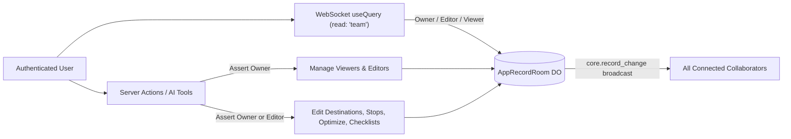

# Trippie — Requirements & Technical Implementation Plan

## Goal Description

Build and deploy **Trippie** (`https://trippie-planner.app.space`), a real-time collaborative AI vacation planner on DeepSpace with a **Sleek Dark Atlas** aesthetic. Users can plan multi-destination trips with date ranges or start in **Broad Overview Mode** to evaluate how many days to allocate per location and what is feasible within a timeframe. A tool-enabled conversational AI concierge steers itineraries to user preferences, discovers sightseeing landmarks, restaurants, day trips, hidden gems, and **photography / golden-hour spots**, and works alongside a deterministic **travel-time route optimizer**, an interactive **route map**, live **weather forecasts**, **budget & packing checklists**, and **server-enforced per-trip sharing (`viewer` vs `editor`)**.

---

## User Review Required

> [!IMPORTANT]
> **Authentication & Billing Posture (`src/integrations.ts` & `src/ai/chat-routes.ts`)**
> - **AI Chat (`POST /api/ai/chat`)** forwards the signed-in user's JWT (`authToken: jwt`), so each signed-in user pays from their own DeepSpace credits for conversational AI turns.
> - **Travel Data Lookups (`serpapi/places-search`, `serpapi/events`, `openweathermap/geocoding`, `openweathermap/forecast`, `openweathermap/current`)** require sign-in (anonymous callers blocked with `401`) and default to `'developer'` billing unless overridden in `src/integrations.ts`. Server actions that invoke `openai/chat-completion` / `anthropic/chat-completion` for structured one-click Overview/Itinerary generation can either forward `callerJwt` (`'user'`-billed) or use owner credits (`'developer'`). Please confirm whether you want structured AI itinerary generation and live Places/Weather lookups billed to **`'user'` (caller credits)** or **`'developer'` (owner credits)**.

> [!NOTE]
> **Subdomain & Display Branding**
> - `wrangler.toml` keeps `name = "trippie-planner"` so the live deploy URL is `https://trippie-planner.app.space`.
> - Display branding uses **Trippie** (`APP_NAME` in `src/constants.ts`, `<title>` in `index.html`).

---

## Functional Requirements Matrix

| Area | Requirement | Implementation Surface |
| --- | --- | --- |
| **Trip & Multi-Location Dates** | Create trips with multiple destinations, arrival/departure dates, travel pace (`relaxed`/`balanced`/`packed`), budget tier, and interests; auto-generate day slots and inter-city transit legs | `trips` + `trip_destinations` collections, `/trips/new`, `src/actions/trip-actions.ts` |
| **Broad Overview Planner Mode** | Enter desired locations + total timeframe (or date window); compute recommended days per stop, transit overhead, feasibility score, and generalized daily highlights; one-click convert to Detailed Itinerary | `trip_overviews` collection, `/overview` & Overview tab on `/trips/[tripId]`, `generateOverviewPlan` action + `trip_generate_overview` AI tool |
| **AI Recommendations** | Discover sightseeing (`must_see`), `restaurant`, `day_trip`, `hidden_gem`, and **`photo_spot`** (with `bestLightWindow` & vantage/lens tips) via live Google Maps Places, Events, and AI curation | `DiscoverPanel.tsx`, `serpapi/places-search`, `serpapi/events`, `src/ai/tools.ts` |
| **Travel-Time & Route Optimization** | Estimate walk / transit / drive leg durations and distances between consecutive stops; optimize day order via anchor-preserving Nearest-Neighbor + 2-opt TSP; flag tight buffers or overpacked days | `src/lib/route-optimizer.ts`, `optimizeTripDay` action, `trip_optimize_day` AI tool |
| **Conversational AI Steering** | Context-aware Copilot dock knows the active trip and day; reads/adds/updates/removes/optimizes stops, checks live weather & events, and adapts plans to conversational constraints | `TripChatContext.tsx`, `ChatDock.tsx`, `ChatPanel.stream.ts`, `src/ai/chat-routes.ts`, `src/ai/tools.ts` |
| **Interactive Dark Atlas Map** | Synchronized Leaflet map (CartoDB Dark Matter tiles + fallback SVG route canvas) with day-colored numbered pins, route polylines, leg time labels, and click-to-focus | `src/components/trip/AtlasMap.tsx` |
| **Weather & Golden Hour Overlay** | Geocode destinations and display 5-day forecast + sunrise/sunset times per day so photo spots and indoor backups align with conditions | `openweathermap/geocoding`, `openweathermap/forecast`, `openweathermap/current` |
| **Sharing & Viewer/Editor RBAC** | Owner invites collaborators by email, user directory pick, or role-scoped share link; specifies **`viewer`** (read-only) or **`editor`** (can mutate itinerary); owner can toggle roles or revoke access | `team_members` + `trip_invites` collections, `ShareTripModal.tsx`, DO RBAC + server-action guards |
| **Real-Time Sync & Presence** | Multiple collaborators see stop edits, optimizations, checklist toggles, and active viewers live over WebSockets | `RecordRoom` subscriptions (`useQuery`) + `PresenceRoom` (`usePresence`) |
| **Budget, Checklists & Export** | Per-stop cost estimates + category budget breakdown; shared packing/booking/gear checklist; print-friendly view and Markdown/JSON export | `trip_checklists` collection, `BudgetChecklistTab.tsx`, `src/lib/export-itinerary.ts` |

---

## Architecture & Security Model

### Per-Trip `viewer` vs `editor` RBAC Enforcement

DeepSpace's `RecordRoom` evaluates `collaboratorsField` (`'collaborator'`) and `team_members` (`'team'`) natively inside the Durable Object before any read or write executes:

```
checkPermissionLevel('team')         => owner || collaboratorsField || team_members(active)
checkPermissionLevel('collaborator') => owner || collaboratorsField
```

By structuring every trip-scoped collection with:
- `ownerField: 'ownerId'` (`userBound: true, immutable: true`)
- `collaboratorsField: 'editors'` (JSON array of `userId`s with `editor` permission, maintained **only** by owner-verified server actions)
- `teamField: 'tripId'` (links to `team_members`, which holds **all** invited `viewer` + `editor` members with `status: 'active'`)

We achieve **three-layer server enforcement**:
1. **WebSocket Read Boundary (`RecordRoom`)**: `read: 'team'` ensures private trips only stream over WebSockets to the trip owner, editors, and invited viewers. Uninvited users receive zero records.
2. **WebSocket Write Boundary (`RecordRoom`)**: `create: false` on child collections (`trip_destinations`, `trip_stops`, `trip_overviews`, `trip_checklists`, `team_members`, `trip_invites`) and `update: 'collaborator'` / `delete: 'collaborator'` (with `trips` restricted to `update: 'own', delete: 'own'`) guarantees a `viewer` cannot mutate records even via raw WebSocket frames.
3. **Server Actions & AI Tools (`src/actions/trip-actions.ts`, `src/ai/tools.ts`)**: Every mutation action (`addTripStop`, `updateTripStop`, `optimizeTripDay`, etc.) calls `assertTripAccess(tools, tripId, userId, 'editor')` before writing; sharing actions (`inviteTripMember`, `setTripMemberRole`, `removeTripMember`, `createTripInviteLink`) require `'owner'`.



---

## Proposed Changes

### 1. Theme, Layout & Static Landing

#### [MODIFY] index.html
- Replace `data-theme="slate"` with `data-theme="atlas"`, update `<title>` to `Trippie — Atlas Vacation Planner`, and update first-paint `<style>` backgrounds for `atlas` (`#090d14`) and `cartographer` (`#f5f3ee`).

#### [MODIFY] src/themes.css & src/themes.ts
- Define `[data-theme="atlas"]` (Sleek Dark Atlas: `#090d14` shell, `#0f1622` raised panel, `#141d2b` card, `#e5a93c` compass-amber primary with `#090d14` primary-foreground, `#e6edf7` foreground, `#8b9bb4` muted-foreground, `#223045` border) and `[data-theme="cartographer"]` (crisp light atlas counterpart with `color-scheme: light`).
- Update `THEMES` metadata array in `src/themes.ts` and toggle ids in `src/components/shell/ThemeToggle.tsx`.

#### [MODIFY] src/constants.ts & src/seo.ts & src/nav.ts
- Set `APP_NAME = 'Trippie'` (keeping `wrangler.toml` `name = "trippie-planner"`).
- Update `src/seo.ts` title and category description.
- Update `src/nav.ts` navigation items:
  - `/home` (`Atlas Home`)
  - `/overview` (`Overview Planner`)
  - `/trips/new` (`New Trip`)
  - `/settings` (`Preferences`)

#### [MODIFY] src/components/sidebar/AppSidebar.tsx & src/components/shell/ChatDock.tsx
- Restyle brand mark with compass/route icon from `lucide-react` while preserving `app-navigation`, `nav-sign-in-button`, `nav-user-name`, `nav-user-email` test hooks.
- Connect `ChatDock` to `TripChatContext` so empty-state steering prompts adapt to the active trip (e.g., *"Add a golden-hour photo spot"*, *"Optimize Day 1 travel time"*) and display a subtle active-trip badge in the dock header.

#### [MODIFY] src/pages/index.tsx
- Write the `Design Direction` block at the top of the file.
- Build a Sleek Dark Atlas static landing page (semantic CSS tokens only, zero hardcoded colors, hero headline 3–8 words, `< 150` words body copy, custom interactive SVG/React atlas route preview component, zero pictograph emojis, preserves `data-testid="static-landing"` and zero auth/WS calls).

---

### 2. Data Schemas & Core Domain Types

#### [NEW] src/schemas/trip-schema.ts
Define and register in `src/schemas.ts`:
- **`team_members`** (required for `'team'` RBAC): `teamId` (tripId), `userId`, `role` (`'viewer' | 'editor'`), `status` (`'active'`), `displayName`, `email`, `addedBy`.
- **`trips`**: `title`, `ownerId` (`userBound: true, immutable: true`), `teamId` (equals `recordId` for `'team'` check), `editors` (`json` array of editor userIds), `viewers` (`json` array of viewer userIds), `mode` (`'detailed' | 'overview'`), `startDate`, `endDate`, `totalDays` (`number`), `pace` (`'relaxed' | 'balanced' | 'packed'`), `budgetTier` (`'budget' | 'moderate' | 'luxury'`), `currency`, `interests` (`json`), `transportPreference` (`'walk' | 'transit' | 'drive'`), `summaryNotes`, `coverDestination`.
- **`trip_destinations`**: `tripId`, `ownerId`, `editors` (`json`), `name`, `country`, `lat` (`number`), `lng` (`number`), `arrivalDate`, `departureDate`, `orderIndex` (`number`), `suggestedDays` (`number`), `minDays` (`number`), `transportFromPrev` (`'flight' | 'train' | 'drive' | 'ferry' | 'bus'`), `transitHoursFromPrev` (`number`), `weatherCache` (`json`), `notes`.
- **`trip_stops`**: `tripId`, `destinationId`, `ownerId`, `editors` (`json`), `dayNumber` (`number`), `orderIndex` (`number`), `title`, `category` (`'must_see' | 'restaurant' | 'photo_spot' | 'day_trip' | 'hidden_gem' | 'lodging' | 'transit'`), `address`, `lat` (`number`), `lng` (`number`), `startTime` (HH:mm), `durationMinutes` (`number`), `fixedTime` (`boolean`), `preferredWindow` (`'any' | 'sunrise' | 'morning' | 'lunch' | 'afternoon' | 'golden_hour' | 'dinner' | 'night'`), `transportMode` (`'walk' | 'transit' | 'drive'`), `travelMinutesFromPrev` (`number`), `travelDistanceKmFromPrev` (`number`), `estimatedCost` (`number`), `rating` (`number`), `photoTip`, `bestLightWindow` (`'sunrise' | 'golden_hour' | 'blue_hour' | 'midday' | 'night' | 'any'`), `notes`, `sourceUrl`.
- **`trip_overviews`**: `tripId`, `ownerId`, `editors` (`json`), `feasibilityStatus` (`'comfortable' | 'ambitious' | 'overpacked'`), `feasibilityScore` (`number`), `totalTransitHours` (`number`), `summary`, `allocations` (`json`: per-location recommended days, min days, rationale, top highlights, day-trip options), `dailyOutline` (`json`: generalized Day 1..N morning/afternoon/evening theme blocks).
- **`trip_checklists`**: `tripId`, `ownerId`, `editors` (`json`), `category` (`'booking' | 'gear' | 'documents' | 'packing'`), `label`, `completed` (`boolean`), `assignedTo`.
- **`trip_invites`**: `tripId`, `ownerId`, `token`, `role` (`'viewer' | 'editor'`), `invitedEmail`, `status` (`'pending' | 'accepted' | 'revoked'`).

#### [MODIFY] src/schemas.ts
- Export `schemas = [usersSchema, settingsSchema, ...aiChatSchemas, ...tripSchemas]`.

---

### 3. Travel-Time Optimizer, Broad Overview Engine & Sample Data

#### [NEW] src/lib/route-optimizer.ts
Pure TypeScript module (shared by frontend preview, worker server actions, and AI tools, covered by Vitest unit tests):
- `haversineKm(a, b)`: Great-circle distance.
- `estimateLegTravel(from, to, mode)`: Estimates duration in minutes and distance in km for `walk`, `transit`, and `drive` with realistic urban detour & transfer buffers.
- `computeDaySchedule(stops, dayStartMinutes)`: Computes sequential `startTime`, `travelMinutesFromPrev`, `travelDistanceKmFromPrev`, total transit time, total activity hours, and schedule warnings (`tight_transition`, `overpacked_day`, `long_transfer`).
- `optimizeDayRoute(stops, dayStartMinutes)`: Preserves `fixedTime` reservations and light-window anchors (`sunrise`, `golden_hour`, `lunch`, `dinner`), applies Nearest-Neighbor + 2-opt local search within each flexible segment to minimize total travel time, and returns `{ optimizedStops, beforeTravelMin, afterTravelMin, minutesSaved, distanceSavedKm }`.

#### [NEW] src/lib/overview-planner.ts
Deterministic baseline allocator + feasibility scorer (augmented by AI when available):
- Given candidate destinations (with coordinates), total days (or start/end dates), and pace (`relaxed` | `balanced` | `packed`), calculates inter-destination transit overhead, allocates recommended days vs minimum viable days per stop, scores feasibility (`comfortable` / `ambitious` / `overpacked`), and builds generalized daily outline blocks.

#### [NEW] src/lib/sample-trip.ts
- Rich, realistic curated **Kyoto & Hakone Autumn Atlas** sample dataset (both Detailed Itinerary + Overview Blueprint) for signed-out `/home` preview and one-click "Clone Sample Trip" onboarding.

---

### 4. Server Actions, AI Chat Context & Custom Travel Tools

#### [NEW] src/actions/trip-actions.ts & [MODIFY] src/actions/index.ts
Register server actions in `src/actions/index.ts`:
- `createTrip`: Creates `trips` + initial `trip_destinations` + `team_members` (owner) + optional starter overview/stops; supports cloning the sample trip.
- `updateTripDetails`: Verifies `editor` or `owner` access; updates title, dates, pace, budget, or mode.
- `deleteTrip`: Verifies `owner` access; cascades delete across `trip_destinations`, `trip_stops`, `trip_overviews`, `trip_checklists`, `team_members`, `trip_invites`.
- `addDestination` / `updateDestination` / `removeDestination`: Verifies `editor` access; geocodes via `openweathermap/geocoding` if coordinates omitted.
- `upsertTripStop` / `removeTripStop` / `moveTripStop` / `optimizeTripDay`: Verifies `editor` access; recalculates day travel-time legs using `route-optimizer.ts` and persists updates.
- `generateOverviewBlueprint`: Verifies `editor` access; combines `overview-planner.ts` math with `openai/chat-completion` (or `anthropic/chat-completion`) + fallback heuristic if credits/network unavailable, producing tailored stay allocations, feasibility analysis, and generalized daily blocks.
- `promoteOverviewToDetailed`: Verifies `editor` access; converts approved overview stay allocations into dated `trip_destinations` and seeds starter `trip_stops` (including photo spots & restaurants).
- `aiGenerateDayItinerary`: Verifies `editor` access; calls `serpapi/places-search` + `openweathermap/forecast` + LLM to generate an optimized, travel-time-aware day schedule with must-sees, restaurants, and photo spots.
- `toggleChecklistItem` / `addChecklistItem` / `removeChecklistItem`: Verifies `editor` access.
- `inviteTripMember` / `updateTripMemberRole` / `removeTripMember` / `createInviteLink` / `acceptTripInvite`: Server-side email resolution against `users`, role validation (`viewer` vs `editor`), and atomic syncing of `trips.editors` / `trips.viewers` / `team_members` + child records' `editors` arrays.
- `getTripCollaborators`: Returns safe `{ userId, name, imageUrl, role }` list for trip members (never leaks emails of non-owned users).

#### [MODIFY] src/ai/tools.ts & src/ai/chat-routes.ts & src/components/chat/ChatPanel.stream.ts
- Extend `buildSystemPrompt` with Trippie-specific vacation concierge guidance (always consider travel time between stops, include photography light windows when suggesting photo spots, respect `viewer` vs `editor` access, confirm before deleting multiple stops).
- Allow `POST /api/ai/chat` to accept optional `tripContext?: { tripId: string; dayNumber?: number }`, validate caller read access to `tripId`, and inject the active trip summary into system instructions.
- Add domain tools to `buildTools` in `src/ai/tools.ts` (all enforcing `assertTripAccess` on `tripId`):
  - `trip_get_itinerary`: Read trip, destinations, stops, overview, checklists.
  - `trip_add_stop`: Add a stop with category, duration, light window, coordinates, and auto-recomputed leg travel time.
  - `trip_update_stop` / `trip_remove_stop`: Modify, reschedule, or remove a stop.
  - `trip_optimize_day`: Run `optimizeDayRoute` and persist the reordered stops + time savings.
  - `trip_generate_overview`: Generate or refine Overview Mode stay durations and feasibility notes.
  - `places_search`: Query `serpapi/places-search` + `openweathermap/geocoding` for real venues, ratings, and coordinates.
  - `weather_lookup`: Query `openweathermap/forecast` & `current` for trip destinations.
  - `events_search`: Query `serpapi/events` for local events during trip dates.
  - `checklist_add`: Add a booking/packing/gear item.

---

### 5. Frontend Workspace & Components

#### [NEW] src/contexts/TripChatContext.tsx
- Provides active trip ID, active day number, and `sendPromptToAssistant(text)` hook connecting trip workspace buttons (e.g. "Ask AI to fill Day 2", "Steer preferences") to `ChatDock`.

#### [NEW] src/components/trip/AtlasMap.tsx
- Interactive Leaflet dark-atlas map using CartoDB Dark Matter tiles (`cartographer` light theme switches to CartoDB Positron), custom numbered circular markers colored by category (`must_see`, `restaurant`, `photo_spot`, `day_trip`, `hidden_gem`), dashed/solid route polylines with travel-time badges, and an SVG coordinate fallback when map tiles are unreachable.

#### [NEW] src/components/trip/ItineraryTimeline.tsx
- Day selector strip (with destination & weather pill per day), "Optimize Route" action showing exact minutes & km saved, ordered stop cards with start/end times, travel-time leg connectors (`14 min walk · 1.1 km`), photo-spot light-window badges (`Golden Hour · 17:15`), inline add/edit stop modal, reorder buttons, and schedule warnings banner.

#### [NEW] src/components/trip/OverviewPlannerView.tsx
- Broad Overview Mode workspace: add/remove target locations, set total trip duration or date range and pace, view proportional timeline bar across locations, feasibility gauge (`Comfortable` / `Ambitious` / `Overpacked`), transit overhead warning, generalized daily theme cards, and **"Convert to Detailed Itinerary"** CTA.

#### [NEW] src/components/trip/DiscoverPanel.tsx
- Live search + AI discovery tabs (`Must-See`, `Restaurants`, `Photo Spots`, `Day Trips`, `Hidden Gems`, `Events`) calling `serpapi/places-search` & `serpapi/events` with loading/error-with-local-retry/empty states (`useAsyncResource` pattern) and 1-click **"Add to Day N"**.

#### [NEW] src/components/trip/ShareTripModal.tsx
- Owner-only sharing dialog: invite collaborator by email or select from app members with explicit **`Viewer` (Read-only)** vs **`Editor` (Can edit)** selector, copy role-scoped invite link, change existing collaborator roles, or revoke access.

#### [NEW] src/components/trip/BudgetChecklistTab.tsx
- Estimated cost breakdown bar + category totals alongside a real-time shared packing, camera gear, visa/document, and reservation checklist.

#### [MODIFY] src/pages/(app)/home.tsx
- Line 1 declaration: `/* home pattern: product-preview-first — active trips hub or interactive Kyoto sample atlas for signed-out visitors */`
- Signed-out: Interactive Kyoto & Hakone sample atlas (Overview + Day 1–2 timeline + Photo Spots + Travel-Time legs + Map) with inline Sign-In CTA.
- Signed-in: My Trips & Shared With Me grid (showing `Owner` / `Editor` / `Viewer` role badges + `Overview` / `Detailed` mode badges), quick-create CTAs, and `EmptyState` with 1-click sample clone when user has 0 trips.

#### [NEW] src/pages/(app)/(protected)/trips/new.tsx & src/pages/(app)/(protected)/overview.tsx
- Dedicated Trip Creation Wizard (Detailed vs Broad Overview) and quick Overview Blueprint creator.

#### [NEW] src/pages/(app)/trips/[tripId].tsx
- Full Trip Workspace with live WebSocket sync, `usePresence` online collaborator indicators, read-only enforcement banner when user is a `viewer`, Overview / Daily Itinerary + Map / Discover / Budget & Checklist tabs, `?invite=<token>` acceptance flow, and Markdown/print export.

#### [MODIFY] src/pages/(app)/(protected)/settings.tsx
- User travel profile preferences (default pace, transport mode, units, photography focus) persisted to `settings` / `users` + account info.

---

## Verification Plan

### Automated Tests
1. **Unit Tests (`npx vitest run`)**:
   - `src/lib/route-optimizer.test.ts`: Verify `estimateLegTravel`, `computeDaySchedule`, anchor-preserving `optimizeDayRoute` time/distance reduction, and schedule warning flags.
   - `src/lib/overview-planner.test.ts`: Verify stay duration allocation, transit overhead calculation, and feasibility scoring (`comfortable` vs `overpacked`).
2. **Type-check & Build (`npm run type-check && npm run build`)**:
   - Verify TypeScript strict compilation and Vite + static prerender build succeed cleanly.
3. **Design & Hygiene Grep Gates**:
   - Run the DeepSpace Anti-AI gate on `src/pages/index.tsx` and product polish grep checks (`no <select>`, `no window.confirm/alert/prompt`, `no placeholder copy`, `no data-theme="slate"`, presence of `home pattern:` and custom `[data-theme="atlas"]`).
4. **Playwright Suite (`npx deepspace test run all`)**:
   - **`tests/smoke.spec.ts`**: Static landing contract (zero auth/WS calls, `<Seo>` tags, custom H1), `/home` preview for signed-out visitors, `/trips/new` & `/overview` & `/trips/[tripId]` route coverage, UI primitives interaction (`ConfirmModal` / `DropdownMenu`), and toast feedback.
   - **`tests/api.spec.ts`**: Auth gating (`401` on unauthenticated action/AI routes), `POST /api/actions/createTrip`, `POST /api/actions/upsertTripStop`, `POST /api/actions/optimizeTripDay`, `POST /api/ai/chat` streaming + persistence, and mocked integration boundary shape checks for `openweathermap/geocoding`, `openweathermap/forecast`, and `serpapi/places-search` (or 1 live smoke check as appropriate).
   - **`tests/collab.spec.ts`**: Two-user Playwright test (`users(2)`):
     - Owner creates a trip and invites User B as **`viewer`** -> assert User B sees live trip updates in real time, **cannot** mutate stops (UI disabled + server action returns `403` Forbidden + direct WS write denied).
     - Owner promotes User B to **`editor`** -> assert User B can add/optimize a stop and Owner sees the change appear in real time without reload.

### Live Deployment & Post-Deploy Verification
1. Commit changes cleanly to git (`git add -A && git commit`).
2. Deploy via `npx deepspace deploy` to `https://trippie-planner.app.space`.
3. Verify live worker health with `npx deepspace logs`, `npx deepspace releases`, and Playwright/browser verification against `https://trippie-planner.app.space` (confirming static landing, signed-in app shell, and theme rendering).
